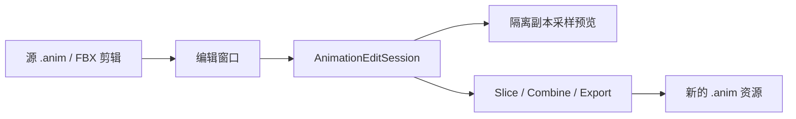

# 动画工具技术设计

适用工程：Unity 6000.3.22f1。本文描述当前仓库源码；`0.0.1` Release 的安装包只包含批量缩放器。

## 模块与依赖

所有工具都位于 `Assets/Editor`，只在编辑器中编译。无需额外 UPM 包或测试框架。

| 模块 | 文件 | 职责 |
| --- | --- | --- |
| 批量缩放入口 | [CN](../Assets/Editor/AnimationBatchScaler_CN.cs)、[EN](../Assets/Editor/AnimationBatchScaler_EN.cs) | 中英文菜单和窗口标题 |
| 批量缩放界面 | [AnimationBatchScalerWindow.cs](../Assets/Editor/AnimationBatchScalerWindow.cs) | 参数、选择、输出目录与状态 |
| 共用资源处理 | [AnimationBatchScalerUtility.cs](../Assets/Editor/AnimationBatchScalerUtility.cs) | 收集剪辑、目录验证、整段变速、资源保存 |
| 分段数据 | [AnimationEditSession.cs](../Assets/Editor/AnimationSegmentEditor/AnimationEditSession.cs) | 编辑工程、片段区间与排列约束 |
| 分段界面 | [AnimationSegmentEditorWindow.cs](../Assets/Editor/AnimationSegmentEditor/AnimationSegmentEditorWindow.cs) | IMGUI 时间线、快捷键、拖拽、命名与保存 |
| 片段及合成导出 | [AnimationSegmentExporter.cs](../Assets/Editor/AnimationSegmentEditor/AnimationSegmentExporter.cs) | 曲线裁切、对象引用、事件及 .anim 导出 |
| 隔离预览 | [AnimationSegmentPreview.cs](../Assets/Editor/AnimationSegmentEditor/AnimationSegmentPreview.cs) | 预览场景副本、采样、镜头与资源释放 |



分段编辑器依赖共用 `AnimationBatchScalerUtility` 的正有限数检查和 Assets 文件夹验证。单独导入分段编辑器时也必须保留该文件。`AnimationBatchScalerRelease.cs` 是旧版 0.0.1 打包辅助脚本，不是编辑器运行依赖；它的导出清单不包含新增分段工具。

## 编辑工程与数据模型

`AnimationEditSession` 是 ScriptableObject，保存一个源 `AnimationClip` 引用及片段列表。它属于 Editor 程序集，是编辑专用数据，不作为 Player 运行时资产类型使用。运行时播放使用导出的 `.anim`。

| 字段 | 含义 |
| --- | --- |
| `source` | 只读使用的源动画引用，支持独立 .anim 或 FBX 子资源 |
| `segments` | 可序列化的片段列表 |
| `name` | 用户填写的片段名称；导出文件名另做合法化 |
| `sourceStart / sourceEnd` | 源动画采样区间，单位秒 |
| `start` | 片段在编辑时间线上的起点 |
| `duration` | 编辑时间线中的片段时长 |
| `colorIndex` | 用于选择片段颜色；颜色使用有限调色板循环 |

`End = start + duration`；工程总时长是所有 `End` 的最大值，包含空隙。预览模型和窗口缩放等属于窗口状态，不保存在编辑工程资产中。

对时间线时刻 `t`，源时间映射为：

```text
u = Clamp01((t - start) / duration)
sourceTime = sourceStart + u * (sourceEnd - sourceStart)
r = duration / (sourceEnd - sourceStart)
```

例如源区间 1–3 秒原长 2 秒，输出时长 1 秒时 `r = 0.5`，播放速度变为原来的两倍。

### 区间与排列约束

- `Validate` 检查源动画、片段数量、数值有限性、源区间合法性、正时长、非负位置和时间线不重叠。
- 调整的帧间隔为 `1 / Max(1, source.frameRate)`。切割点及用户输入的位置/时长按该间隔吸附。
- `Split` 在吸附后把源区间和时间线区间按相同比例切开，新段命名追加 `_A / _B`，并分配新的颜色索引。距两端不足半帧的切割被拒绝；源末尾不在整帧时，末段可小于一帧。
- `Move` 从吸附后的请求位置、零点及其他片段边界构建候选集，选取距离请求位置最近且不重叠的位置；移动后重新排序。它不是自动推移后续片段的波纹编辑。
- `Resize` 固定左端与源区间，调整时间线时长。先按帧吸附并限制至少一帧，再限制不能越过下一个片段起点；若剩余空位不足一帧，邻段边界限制优先。
- `At` 使用左闭右开的时间线区间。空隙取上一段末姿态；第一段之前取首段初姿态。没有跨段混合或交叉淡化。

## 界面与撤销

界面沿用工程现有的 IMGUI。左侧缓存源曲线绑定和关键帧时间，显示浮点/对象引用轨道与动画事件；白色边界方点表示切割导出会补充的边界采样，菱形表示原关键帧。

时间轴坐标换算为：

```text
x = timelineOriginX + time * pixelsPerSecond - horizontalScroll
```

C/W/S 在窗口 `KeyDown` 时切换工具；编辑文本或按住 Ctrl/Cmd/Alt 时不处理这些快捷键。C 点击裁切所在片段；W 拖动色块；S 仅在右端约 12 像素的命中范围内开始拖拽。时间尺或非切割模式的关键帧区域可拖动播放头。

拖拽使用 `GUIUtility.hotControl` 持有鼠标，起始时记录一次完整对象 Undo；后续鼠标移动基于起始位置/时长计算，避免累计误差。普通命名、数值编辑、切割和删除同样记录 Session 的 Undo 并标记 Dirty。

新建工程先保存在内存中；“保存编辑工程”创建 `.asset`。载入已保存工程后，编辑会标记该资产 Dirty，保存按钮调用资产保存。Unity 的其他资产保存操作也可能保存 Dirty 数据。导出动画与保存编辑工程是两个独立操作。

## 批量缩放算法

`CollectClips` 仅处理 `.anim` / `.fbx`；选择模型时收集有效子剪辑，选择剪辑子资源时只处理该剪辑。通过集合去重，并跳过预览名称。

`CreateScaledClip` 复制源剪辑，按比例 `r` 变换：

```text
newKeyTime = oldKeyTime * r
newTangent = oldTangent / r
newEventTime = oldEventTime * r
```

关键帧结构体保留权重和加权模式；对象引用键的值不变，仅改变时间；剪辑设置的起止时间同步调整。

可写且为主资产的独立 `.anim` 覆盖时，使用 `CopySerialized` 更新原对象，保留 GUID 与引用。其他情况创建新的资源路径。覆盖与新建都记录 Undo。

## 独立片段导出

`Slice` 克隆剪辑后清空旧曲线和事件，再写入裁切后的数据，并把输出剪辑设置为从零开始、在 `duration` 结束。帧率及其他复制的剪辑设置保留。

### 浮点曲线

`SliceCurve` 对每个与裁切区间相交的相邻键区间进行处理：

1. 用关键帧时间、值、切线和权重构造时间—值平面的三次贝塞尔控制点。未加权的一侧使用 `1/3` 权重。
2. 用 32 次二分查找，把源时间边界转换为贝塞尔参数。
3. 通过 De Casteljau 分割控制多边形，保留裁切范围内的曲线。
4. 从新控制点重建键值、切线与权重，并把时间变换到片段本地；切线除以变速比例。
5. 合并相邻区间的共有边界键，保留入/出切线；对无穷切线分支保留阶梯变化。

该过程以浮点数运算，目标是保持普通和加权曲线的裁切形状，不要求输出关键帧的切线模式元数据与源文件逐字相同。自动切线会以计算后的形状导出。回归通过密集采样比较裁切前后的值。

对于源键范围之外的 Loop/PingPong 曲线，改用约源帧率的均匀采样，并线性连接采样点；这类片段的帧间结果是近似值。普通短轨道在范围外补充边界状态。

### 对象引用与事件

- 对象引用曲线在本地零点写入源区间起点时的状态，再变换内部键时间，末尾补充保持键。源区间起点之前没有键时，初始引用为 null。
- 事件使用 `[sourceStart, sourceEnd)`；若区间到达源动画末尾，则包含源末尾事件。
- 事件时间变换为 `(eventTime - sourceStart) * r`，事件名称及参数保留。一次切割的边界事件只进入右侧片段。

## 完整时间线导出

`Combine` 先创建各片段的临时裁切剪辑，再遍历源曲线绑定：

- 浮点曲线以 `Max(1, source.frameRate)` 采样，补充零点、末尾及片段起止点。
- 在每段起点前补充一个很近的采样点，距离为 `Min(0.00001 秒, frameInterval * 0.001)`，避免把姿态切换摊到整个相邻帧间。该极短区间仍是线性插值，不是数学意义上的零宽跳变。
- 每个采样点通过 Session 查询所属片段或保持姿态；输出采样点间使用线性切线。因此帧间曲线不保证与源贝塞尔曲线完全相同。
- 对象引用键按片段起点平移，相同时间由后面的片段状态覆盖；事件平移到时间线后排序。

合成时长等于 Session 总时长。单条曲线的采样计数超过 1,000,000 时拒绝导出；这是计数保护，不是总内存预算。长动画或大量绑定仍可能产生较大导出资源。

## 资源写入与预览生命周期

`Export` 只允许当前工程 Assets 内已存在的文件夹，且至少选择一种输出。它先准备内存剪辑，再生成唯一资源路径、写入并保存。片段按时间线顺序编号，非法文件名字符替换为下划线。写入阶段失败会删除本次已创建的资源；未持久化的临时剪辑在 finally 中释放。

原动画与 FBX 不被导出流程覆盖；重新导出产生新的唯一文件名。导出资产创建归为一个 Undo 组。

预览使用 `PreviewRenderUtility` 的隔离场景：

1. 在隔离场景中创建未激活的隐藏容器，再在其下克隆预览模型。
2. 激活前移除副本的 MonoBehaviour，禁用音频并停止粒子系统。
3. 只对副本调用 `AnimationClip.SampleAnimation`，不对用户场景对象或资产执行采样。
4. 根据包围盒设置镜头，跟随根位置偏移，支持旋转和缩放。
5. 切换模型、关闭窗口或禁用窗口时，销毁副本、容器并 Cleanup 预览场景。

此预览不执行游戏逻辑、事件接收器、Animator 状态机或 IK/约束求值。Humanoid、根运动及特殊导入器需要用实际项目素材进一步验收。

## 测试与复现

现有结果由本地 Unity 6000.3.22f1 生成：

| 入口 | 覆盖范围 | 已记录结果 |
| --- | --- | --- |
| `AnimationBatchScalerTests.Run` | 原批量缩放、权重/设置/事件、GUID、Undo、目录、FBX | 8 场景 / 68 断言 |
| `AnimationSegmentEditorTests.Run` | 切割边界、加权裁切、阶梯/短轨道/包裹、移动缩放、对象事件、合成、导出、Session、FBX、隔离预览及快捷键 | 9 场景 / 479 断言（启用图形设备） |
| `AnimationSegmentEditorVisualTests.Run` | 普通编辑器中的真实窗口事件：C 鼠标切割、W 拖拽重排、S 右端缩放、模型渲染纹理 | PASS |

前两个入口用 `unity run` 运行，命令见 [README](../README.md#验证与限制)。无图形模式可用于纯数据回归，但会跳过分段窗口的图形快捷键断言，因此断言数量不同。

图形交互验收必须使用一个专用、普通编辑器进程。关闭本工程后，在工程根目录执行：

```powershell
$editorPath = "D:/Program Files/UnityHub/6000.3.22f1/Editor/Unity.exe"
$visualLog = Join-Path (Get-Location).Path "Logs/segment-visual.log"
$editorArgs = '-executeMethod AnimationSegmentEditorVisualTests.Run -logFile "' + $visualLog + '"'
unity open . --editor-path $editorPath --args $editorArgs
```

按本机安装位置替换 `$editorPath`。Windows 下 `unity open` 不使用 `--wait`，启动后通过报告和日志确认完成。

该验收入口会模拟窗口事件并在结束时退出自身编辑器进程，不能对含未保存工作、已打开的编辑器执行。它创建并清理 `Assets/__AnimationSegmentVisual`；已有同名目录时拒绝覆盖。其他数据测试同样使用专用临时目录。

报告与图像：

- [原工具回归](../TestReports/regression.txt)
- [分段工具回归](../TestReports/segment-editor.txt)
- [图形交互验收](../TestReports/segment-editor-ui.txt)
- [预览渲染纹理](../TestReports/segment-preview.png)：直接读取预览纹理，不捕获桌面或其他应用

## 维护边界

当前实现为单源、单轨道的分段时间编辑器。尚未实现多动画混剪、多轨重叠、过渡混合或完整逐关键帧数值编辑。改变 Session 数据结构时应考虑已有 `.asset` 的序列化兼容性；更改上述算法时，优先扩展现有边界、事件归属、源资产不变性和图形拖拽用例。

当前测试没有宣称覆盖所有第三方 FBX、Humanoid 根运动、运行时状态机或约束系统。仅改变文档时，可检查链接与差异；改变数据、导出或交互逻辑时，应执行对应回归并更新报告。
