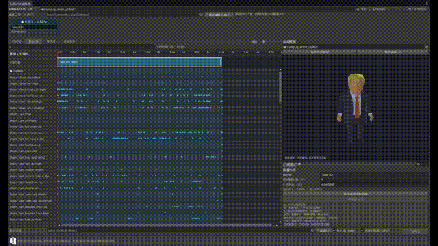
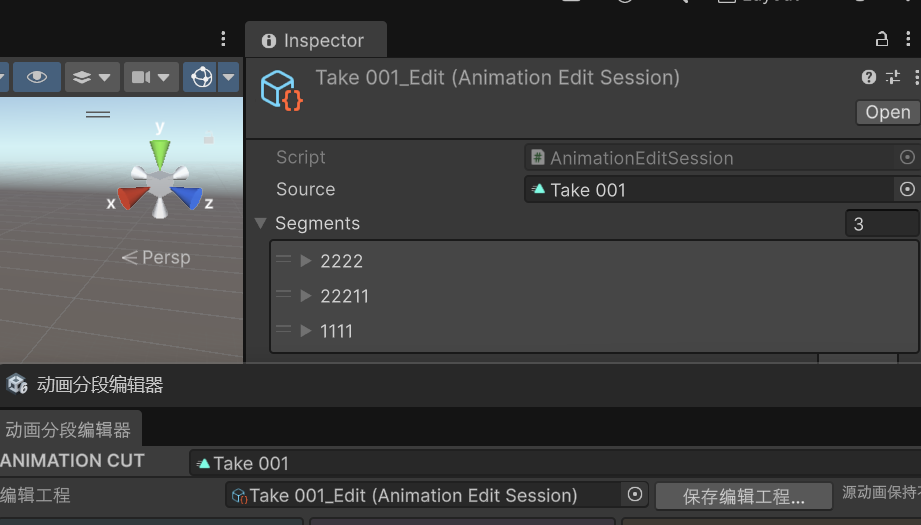
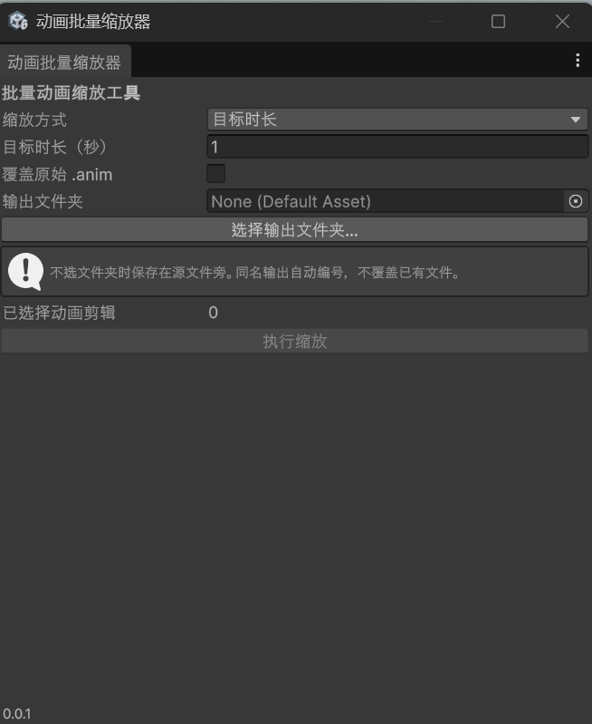

# Unity 动画工具集

[English](README.md) | [简体中文](README.zh-CN.md)

用于处理独立 `.anim` 和 FBX 内嵌动画的 Unity 编辑器工具：用**动画分段编辑器**切割、重排和调整局部速度，用**动画批量缩放器**统一调整多个动画的时长。

## 选择适合的工具

| 你想做什么 | 使用工具 | 菜单入口 |
| --- | --- | --- |
| 拆分动画、重排片段、调整某一段的播放速度 | 动画分段编辑器 | `Tools > 动画分段编辑器` |
| 将多个动画改为指定时长，或按同一比例变速 | 动画批量缩放器 | `Tools > 动画批量缩放器` |



[观看完整操作视频](Documentation/Media/segment-editor-demo.mp4)

## 安装

项目使用 **Unity 6000.3.22f1** 开发和验证，其他版本尚未验证。工具仅在编辑器中运行，无需额外安装 UPM 包。

### 导入 1.0.0 安装包

1. 在 [1.0.0 发布页](https://github.com/sakeka56/Unity-AnimationClipTools/releases/tag/1.0.0)下载 `UnityAnimationTools-1.0.0.unitypackage`。
2. 在 Unity 中选择 `Assets > Import Package > Custom Package…`，选择该文件并导入全部内容。
3. 等待编译完成，从 Tools 或 Window 菜单打开工具。1.0.0 安装包包含两套工具。

### 使用源码放入已有项目

1. 下载或克隆本仓库。
2. 将以下文件和文件夹复制到你的项目 `Assets/Editor` 下，并保留各自的 `.meta` 文件：

   ```text
   Assets/Editor/
   ├── AnimationBatchScaler_CN.cs
   ├── AnimationBatchScaler_EN.cs
   ├── AnimationBatchScalerUtility.cs
   ├── AnimationBatchScalerWindow.cs
   └── AnimationSegmentEditor/       （整个文件夹）
   ```

3. 回到 Unity，等待脚本编译完成，即可从菜单打开工具。

不需要复制 `Tests` 和 `AnimationBatchScalerRelease.cs`。如果只使用分段编辑器，复制 `AnimationSegmentEditor/` 和 `AnimationBatchScalerUtility.cs`，并保留对应 `.meta` 即可。

### 直接打开本工程

克隆仓库后，在 Unity Hub 中添加仓库根目录，使用 Unity **6000.3.22f1** 打开。

[0.0.1 发布包](https://github.com/sakeka56/Unity-AnimationClipTools/releases/tag/0.0.1) **只包含批量缩放器**。需要两套工具时，请使用当前仓库源码。

## 动画分段编辑器

打开 `Tools > 动画分段编辑器`，也可以使用 `Window > Animation > Animation Segment Editor`。分段编辑器目前为中文界面。

### 1. 载入动画

从 Project 窗口将 `.anim` 或 FBX 拖入窗口左上角的源动画插槽。FBX 内有多个动画时，通过旁边的下拉框选择。也可以先在 Project 中选中资源，再点击**载入所选动画**。

左侧会显示关键帧轨道和动画事件。点击或拖动时间尺可移动播放头，搜索框可用于查找轨道。

**切换源动画会新建编辑工程，请先保存当前编辑。**

### 2. 预览模型

在右侧预览栏指定匹配的模型或 Prefab。FBX 动画会优先尝试同文件模型；独立 `.anim` 也会尝试当前选择的模型、场景中引用该动画的对象。

- **自动定位模型**：重新尝试查找可用的预览对象。
- **模型居中 / F**：按照当前姿态重新取景。
- 在预览区域拖动可旋转视角，滚轮可缩放。
- 按**空格**或点击**播放**可播放、暂停。

模型层级及动画绑定路径应与动画匹配。仅含骨骼的 FBX 需要另行指定带网格的匹配模型；Humanoid 动画需要匹配的 Avatar。

对于没有自带可渲染模型的动画，手动指定的模型会被记为本项目的默认预览模型。带模型的 FBX 仍优先使用自身模型。预览采样模型副本，不修改场景原对象。

### 3. 切割、重排与变速

| 工具 | 怎样操作 | 效果 |
| --- | --- | --- |
| **C — 切割** | 点击片段色块或对应关键帧区域 | 在最近帧位置拆成两段 |
| **W — 移动** | 拖动彩色片段 | 移到空位，或拖过其他片段进行重排 |
| **S — 缩放** | 拖动彩色片段的任意位置，支持连续拖动 | 左端固定，改变该段时长和播放速度 |

也可以先移动播放头，再点击**切播放头**。

选中片段后，可在右侧精确填写 **Name**、**时间线位置（秒）**、**片段时长（秒）**。上方片段卡片也可以修改名称。点击**恢复本段原始时长**可还原该段时长，点击**移除此片段**可从排列中移除它。

例如：将一个 3 秒动画在第 1 秒、第 2 秒切开，选中中间片段，将时长设为 0.5 秒，该段就变为两倍速。如需消除留下的空隙，再用 W 把后一个片段移近。

片段不能重叠，放大时长时会在下一个片段起点处停止；需要更多空间时，先移开后面的片段。移动不会自动推移后续片段。片段间的空隙保持前一段末帧，片段切换直接衔接，不做混合过渡。

操作效果见文档开头的动图，也可[观看完整视频](Documentation/Media/segment-editor-demo.mp4)。

### 4. 保存可继续编辑的工程

点击**保存编辑工程…**，生成 `AnimationEditSession` 类型的 `.asset`。它保存源动画引用、片段名称、源区间、时间线位置和时长。

下次将该资源放入窗口上方的**编辑工程**栏，即可继续编辑。关闭窗口或切换动画前请保存。预览模型和窗口布局不包含在这个资产中。

### 5. 导出动画

1. 在**输出目录**中选择当前项目 **Assets 内的文件夹**。点击**选择…**也可以在弹窗里新建目录。
2. 按需勾选一种或两种导出内容：

   | 选项 | 生成内容 | 适合用途 |
   | --- | --- | --- |
   | **各片段 .anim** | `01_Name.anim`、`02_Name.anim` 等，各段从 0 秒开始 | 将每一段作为独立动画使用 |
   | **完整时间线（按帧）** | `SourceName_Edited.anim` | 将整个编辑结果作为一条动画使用 |

3. 点击**一键导出**，将生成的 `.anim` 用于后续动画流程，例如放入 Animator Controller。

导出不修改源动画，遇到同名文件会自动编号。完整时间线包含重排、变速和空隙；其中的浮点曲线按源帧率采样，帧间插值可能与原曲线不同。

**导出不会自动保存编辑工程。** 需要以后继续调整时，请同时保存 `.asset`。编辑工程为编辑器专用，运行时播放使用导出的 `.anim`。



图中 `.asset` 保存了源动画引用和三个片段，可在“编辑工程”栏重新载入。

### 时间轴快捷操作

| 按键 / 鼠标 | 操作 |
| --- | --- |
| C / W / S | 切换切割 / 移动 / 缩放工具 |
| 空格 | 播放 / 暂停 |
| F | 预览模型居中 |
| Alt＋滚轮 | 以鼠标所在时间为中心缩放时间轴 |
| 鼠标中键拖动 | 左右平移时间轴，同时上下滚动轨道 |
| 普通滚轮 / Shift＋滚轮 | 上下 / 左右滚动 |
| Ctrl/Cmd＋Z | 撤销编辑或导出 |

编辑文本时不会触发工具切换快捷键。片段编辑和导出支持 Unity 撤销、重做。

## 动画批量缩放器

1. 打开 `Tools > 动画批量缩放器`；英文界面入口为 `Tools > Animation Batch Scaler`。
2. 在 **Project** 中选中一个或多个 `.anim` / FBX。选中 FBX 会处理其中的有效动画；只选中某个动画子资源则只处理该动画。重复选择会去重，预览剪辑会跳过。
3. 选择**目标时长**或**时长比例**，填写大于 0 的数值。
4. 选择 **Assets 内已存在的输出文件夹**；留空时保存在各自源文件旁。
5. 点击**执行缩放**。

| 模式 | 示例 | 结果 |
| --- | --- | --- |
| 目标时长 | 填写 `1.5` | 每个处理的动画都变为 1.5 秒 |
| 时长比例 | 填写 `0.5` | 时长减半，速度加倍 |
| 时长比例 | 填写 `2` | 时长加倍，速度减半 |

**新时长 = 原时长 × 比例。** 工具调整动画时间，不改变位置数值、模型大小等属性值。

默认生成 `ClipName_scaled.anim`，同名自动编号。勾选**覆盖原始 .anim**后，可写的独立 `.anim` 会原地更新，保留 GUID 和已有引用；FBX 内嵌动画、只读剪辑仍导出为新文件。操作支持撤销。

缩放保留曲线加权信息、循环方式、对象引用轨道、动画事件参数、帧率和剪辑设置，关键帧与事件时间同步缩放。零时长剪辑会跳过。



图中尚未选择动画，因此执行按钮为灰色；先在 Project 中选择动画资源即可继续。

## 常见问题

| 问题 | 处理方法 |
| --- | --- |
| 找不到工具菜单 | 确认脚本位于 `Assets/Editor`、依赖文件齐全，并检查 Console 中是否有编译错误 |
| 预览空白或模型不动 | 指定匹配且带网格的模型，检查绑定路径 / Avatar，再按 F 居中 |
| 片段无法继续拉长 | 先移开后一个片段，时间线上不允许重叠 |
| 导出按钮不可用 | 确认已载入源动画、选择 Assets 内的目录，并至少勾选一种导出内容 |
| 执行缩放按钮不可用 | 在 Project 中选择 `.anim` / FBX，并输入大于 0 的有限数值 |
| 重开后找不到之前的分段 | 载入保存的编辑工程 `.asset`；导出的 `.anim` 不保存可继续编辑的排列信息 |

分段编辑器展示关键帧并编辑片段。需要修改单个关键帧数值时，请使用 Unity Animation 窗口。预览不执行游戏脚本、动画事件接收器或运行时状态机。第三方 DCC 文件、Humanoid 根运动及 IK / 约束流程，请结合自己的资源验证。

## 更多文档

- [中文简明 Word 指南与离线视频](https://github.com/sakeka56/Unity-AnimationClipTools/releases/download/1.0.0/UnityAnimationTools-1.0.0-Guide.zh-CN.zip)
- [1.0.0 发布验证记录](Documentation/Releases/1.0.0.md)

- [分段编辑器详细使用说明](Documentation/AnimationSegmentEditor.md)
- [技术设计与维护说明](Documentation/TechnicalDesign.md)
- 已有回归报告：[批量缩放](TestReports/regression.txt)、[分段编辑](TestReports/segment-editor.txt)、[导航与目录](TestReports/segment-navigation.txt)、[图形交互](TestReports/segment-editor-ui.txt)。这些是仓库中保留的 Unity 6000.3.22f1 验证记录。
- [许可证](LICENSE.txt)

## 支持作者

如果这些工具对你有帮助，欢迎扫码赞助，支持后续开发与维护。感谢支持！


